<div align="center">


# Stackyard

**Your whole local dev stack in one fast desktop app. No containers.**

PHP, Node.js, MySQL, PostgreSQL, Redis and more, running natively on Windows, macOS and Linux,
with local HTTPS sites like `https://myapp.stack` and a built-in MCP server for AI coding tools.

[](https://github.com/ljamov/Stackyard/releases/latest)
[](https://github.com/ljamov/Stackyard/actions/workflows/ci.yml)
[](LICENSE)


[**Download**](https://github.com/ljamov/Stackyard/releases/latest) ·
[Website](https://ljamov.github.io/Stackyard/) ·
[Features](#features) ·
[Quick start](#quick-start) ·
[CLI](docs/cli.md) ·
[MCP](docs/mcp.md) ·
[What's new](https://ljamov.github.io/Stackyard/changelog.html) ·
[Contributing](CONTRIBUTING.md)

<br>

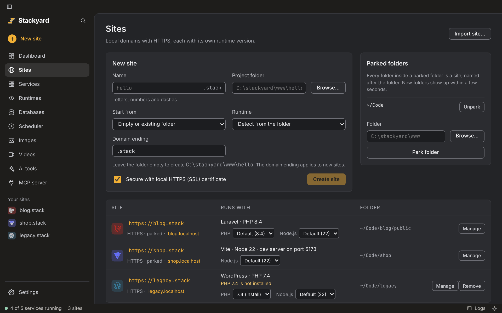

</div>

## Why Stackyard

- **Native, not virtual.** Services run straight on your OS. No Docker, no VM, no waiting for
  containers to boot.
- **Per-project versions.** One project on PHP 8.2, the next on 8.5, a third on Node 22. The browser
  and the terminal always agree on which version a project uses.
- **Real HTTPS on real-looking domains.** Every project gets `https://<name>.stack` with a trusted
  certificate, set up with one click.
- **Small and switch-off-able.** Every runtime, service and screen is a module. Off means nothing is
  downloaded, nothing runs and the screen is gone.
- **AI-ready.** A built-in MCP server lets Claude Code, Cursor and others see your stack, and act on
  it only where you allow.

## Features

<table>
<tr>
<td width="50%" valign="top">

### 🌐 Sites and HTTPS
- Local domains ending in `.stack` (or `.test`, or any ending you like)
- Trusted HTTPS for every site, powered by Caddy
- **Park a folder** and every project inside becomes a site
- Detects Laravel, Symfony, WordPress, Drupal, Craft, Magento, Vite, Next.js, Astro and more
- Node dev servers proxied automatically; static sites served as is
- **Django, FastAPI, Flask, Go, Spring Boot, Quarkus and Micronaut** apps run by Stackyard and served over HTTPS
- **Starters**: a new WordPress, Laravel or Astro site in one click, database and config included
- **Per-site settings**, one-click **backups** of files and database, **export and import** to move a site, and optional **public links**

</td>
<td width="50%" valign="top">

### ⚙️ Runtimes
- **PHP 8.1 to 8.5** (plus 7.4 and 8.0 on Windows) and **Node.js 20 to 26**, side by side
- **Python 3.11 to 3.15**, **Go 1.25 to 1.27** and **Java 11 to 25** (Temurin), each a module you switch on
- Pin a version per project with a `.stackyard` file (or an existing `.nvmrc`, `.php-version`, `.tool-versions`)
- `php`, `composer`, `node`, `npm`, `python`, `pip`, `go`, `java` and `mysql` pick the right version in any terminal
- Every download checked against a published SHA-256
- Own `php.ini` per PHP version

</td>
</tr>
<tr>
<td valign="top">

### 🗄️ Databases and services
- **MySQL 8.4**, **MariaDB 11.8**, **PostgreSQL 18**, **Redis 8**
- **MongoDB 9.0**, **SeaweedFS** (S3-compatible storage), **NATS** (message queue)
- **Meilisearch** for search, **Mailpit** to catch outgoing mail
- Everything listens on `127.0.0.1` only
- A port another app holds? The service moves to the next free one and keeps it
- Data kept when a service is removed, so reinstalling brings it back

</td>
<td valign="top">

### 🧰 Built-in tools
- **Databases screen**: browse tables, run SQL, back up and restore
- **phpMyAdmin** in one click, already logged in to your local database
- **Image optimizer**: WebP, AVIF and smaller JPG/PNG for a whole site folder
- **Video optimizer**: web-ready MP4, WebM and GIF copies with FFmpeg, downloaded on first use
- **Live logs** for every service, with text and regex search
- **Task scheduler** with crontab syntax, in each project's folder
- **Servers and Git per site**: upload and download over SFTP, FTPS or FTP; pull, commit and push to GitHub
- **Disk space cleanup** that never touches your projects

</td>
</tr>
<tr>
<td valign="top">

### 🤖 AI coding tools
- **Install Claude Code, Codex, Gemini CLI, GitHub Copilot CLI, Qwen Code and OpenCode** in one click, on Stackyard's own Node.js
- Update them from the same screen; **Open** starts one in a new terminal in a site's folder
- `stackyard mcp` works with Claude Code, Cursor, Claude Desktop, Windsurf
- Lists sites, services and databases, reads logs, starts, stops and restarts services, runs SQL
- Read-only by default; you allow each action in Settings
- Never offers to delete sites, whole databases or files
- Every call is logged with the tool's name

</td>
<td valign="top">

### 🖥️ Desktop and CLI
- A first-run setup screen picks your folders and what to install
- Lives in the tray (menu bar on macOS) with services running in the background
- A full `stackyard` CLI that drives the same engine as the app
- Signed auto-updates with release notes, installed when you choose
- Dark, light or system theme, six accent colors, and seven languages (add your own with one file)
- Windows 10/11, macOS 11+ (Intel and Apple silicon), Linux x64

</td>
</tr>
</table>

## Quick start

1. **Download** the installer for your system from the
   [latest release](https://github.com/ljamov/Stackyard/releases/latest):

   | System | File |
   | --- | --- |
   | Windows 10 and 11 (x64) | `Stackyard_<version>_x64-setup.exe` (no admin needed) or `.msi` |
   | macOS 11 or later | `.dmg`, `aarch64` for Apple silicon or `x64` for Intel |
   | Linux (x64) | `.deb`, `.rpm` or `.AppImage` |

   > The installers are not code-signed yet, so the first start needs one extra click. On Windows
   > choose **More info**, then **Run anyway**. On macOS right-click Stackyard and choose **Open**.

2. **Open Stackyard.** The first-run screen asks where to keep Stackyard's files and your sites
   (`C:\stackyard` and `C:\stackyard\www` on Windows) and what to install. Then click **Set up** on
   the Sites screen. It asks for your password once to
   make `.stack` names and HTTPS work. Until then, every site also works at `<name>.localhost`.
3. **Add a site**, start one from WordPress, Laravel or Astro, or park your code folder so every
   project in it becomes one.
4. **Start Caddy** (and MySQL if you need it) from the Dashboard, then open `https://<name>.stack`.

Prefer the terminal? The same steps as commands:

```sh
stackyard system setup                 # local domains and HTTPS
stackyard sites park ~/Code            # every folder in ~/Code becomes a site
stackyard runtimes install php 8.4
stackyard sites new blog wordpress    # a ready WordPress site at https://blog.stack
stackyard start                        # run every installed service in the background
stackyard use php 8.3                  # pin a version for the current project
```

## A quick look

<table>
<tr>
<td width="50%">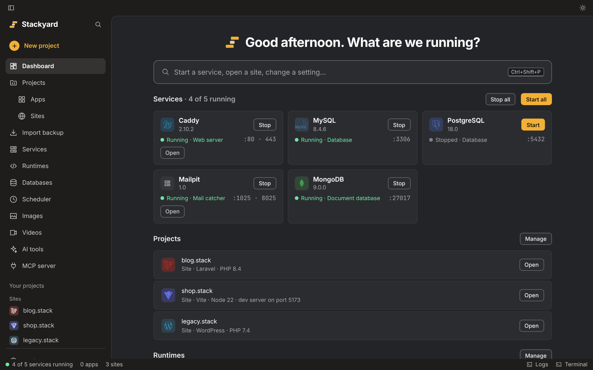</td>
<td width="50%">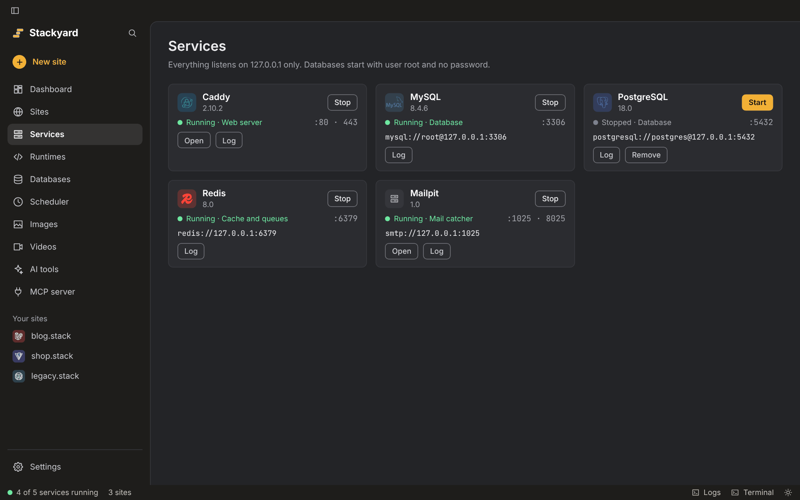</td>
</tr>
<tr>
<td>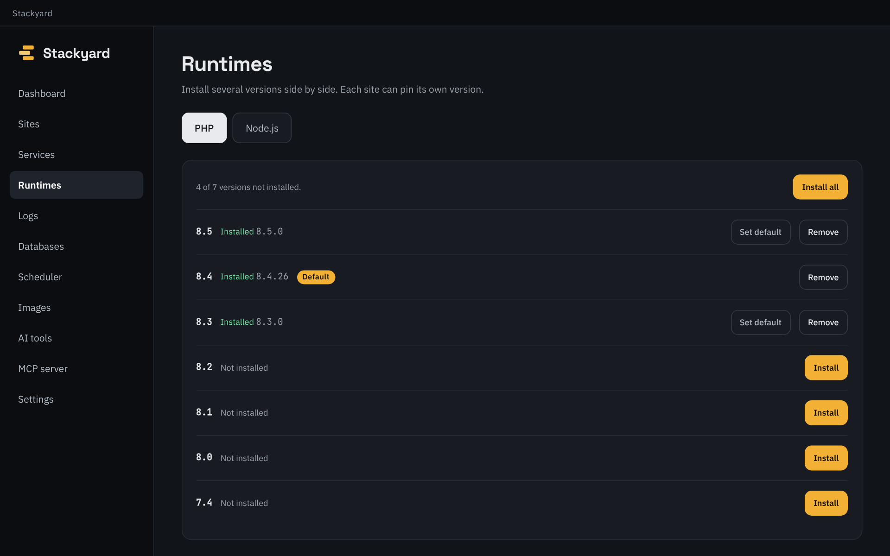</td>
<td>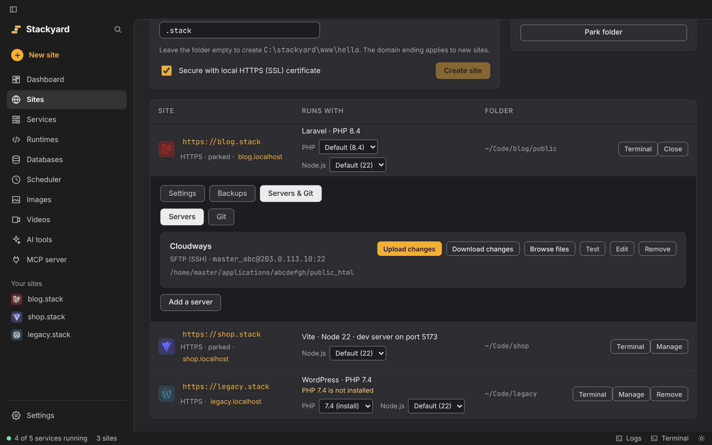</td>
</tr>
<tr>
<td>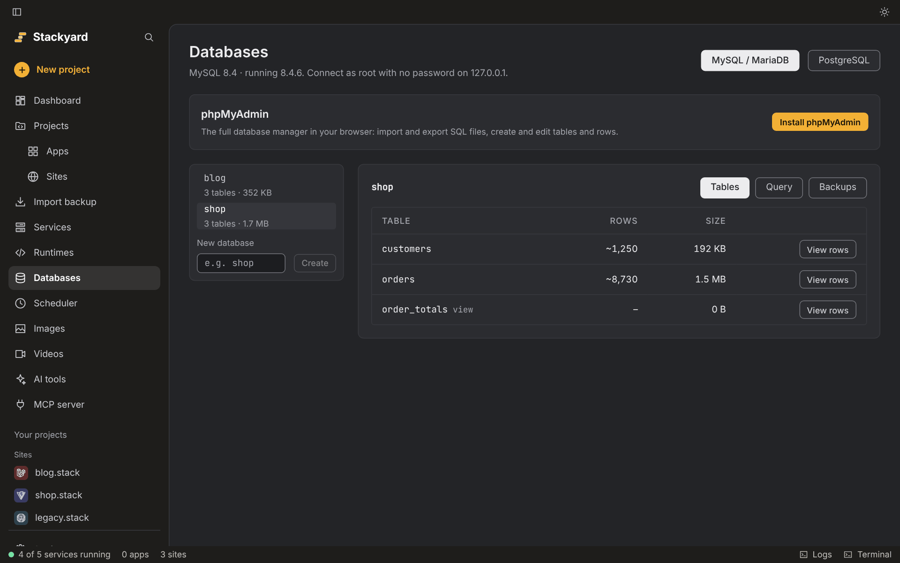</td>
<td>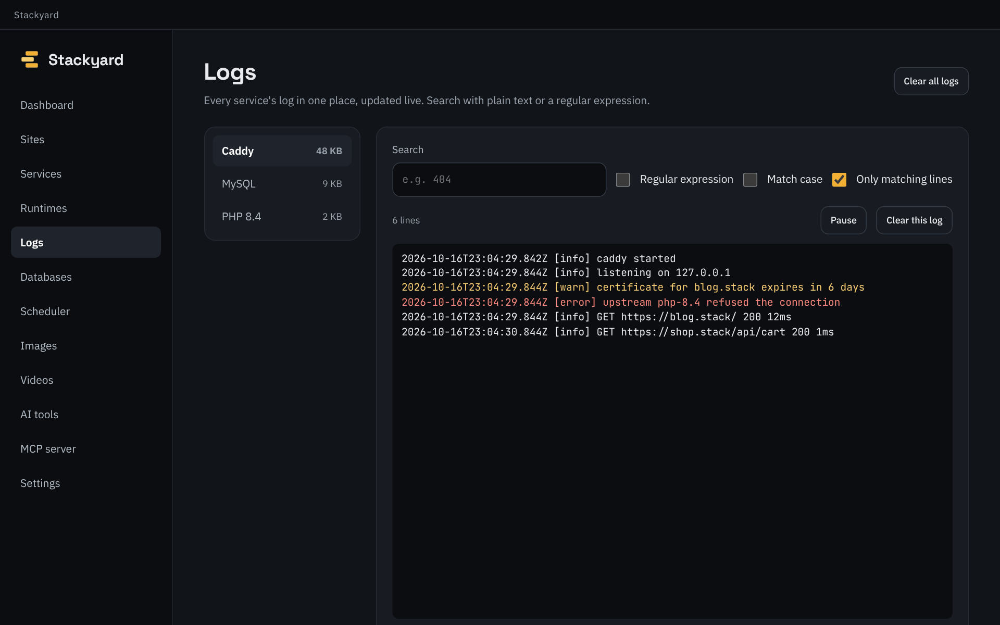</td>
</tr>
<tr>
<td>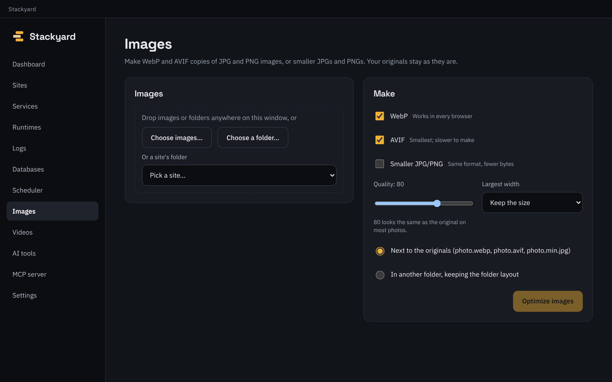</td>
<td>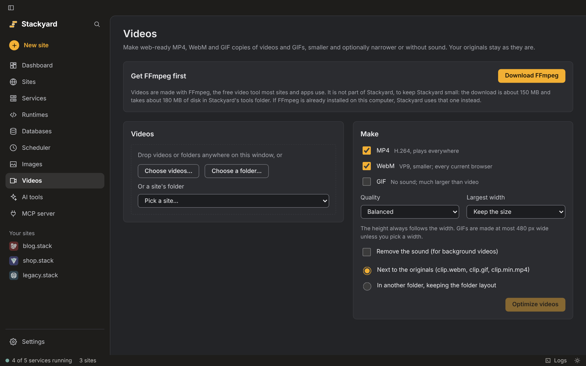</td>
</tr>
<tr>
<td>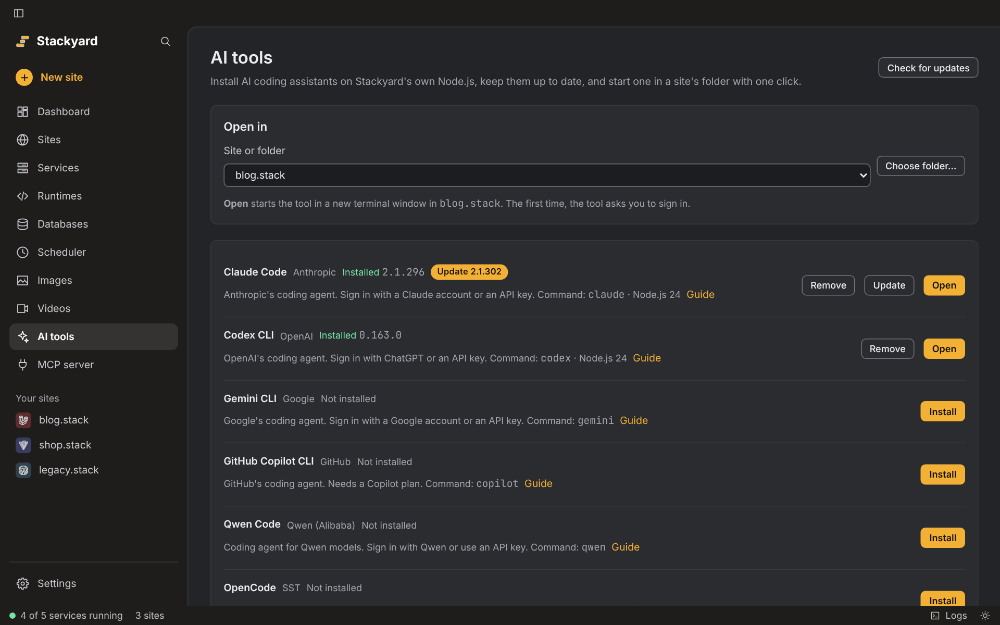</td>
<td>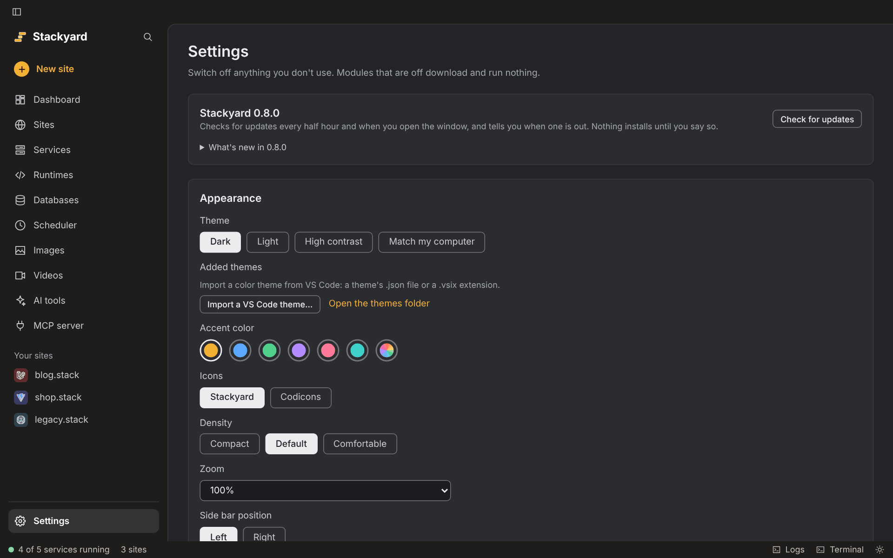</td>
</tr>
</table>

## What you get out of the box

| Service | Port | Platforms | Default |
| --- | --- | --- | --- |
| Caddy 2 (web server, HTTPS) | 80, 443 (8080, 8443 when taken) | All | On |
| MySQL 8.4 | 3306 | All | On |
| MariaDB 11.8 | 3306 | Windows, Linux | Off |
| PostgreSQL 18 | 5432 | All | Off |
| Redis 8 | 6379 | macOS, Linux | Off |
| Meilisearch 1 | 7700 | All | Off |
| Mailpit | 1025 (SMTP), 8025 (web) | All | Off |
| MongoDB 9.0 | 27017 | All | Off |
| SeaweedFS 4 (S3 storage) | 8333 (S3), 23646 (web) | All | Off |
| NATS 2 (queue) | 4222, 8222 (web) | All | Off |

When a port is taken by another app, the service uses the next free port and keeps it.
MySQL and MariaDB start with user `root` and PostgreSQL with user `postgres`, all without a
password. Switch modules on in **Settings** or with `stackyard modules on <id>`.

## Pin versions per project

Drop a `.stackyard` file in a project (or run `stackyard use php 8.3`):

```toml
php = "8.3"
node = "22"
```

The site in your browser and the `php`/`node` commands in your terminal both follow it. An existing
`.nvmrc`, `.node-version`, `.php-version` or `.tool-versions` works too. Without one, Stackyard uses
the site's version, then your default, then the newest installed. The Sites screen has a PHP and a
Node.js picker on each site, and installs a missing version for you.
`stackyard which` shows what each command will run, and why.

## AI coding tools

The **AI tools** screen installs Claude Code, Codex CLI, Gemini CLI, GitHub Copilot CLI, Qwen Code
and OpenCode with npm on Stackyard's own Node.js, shows when an update is out, and opens a tool in a
new terminal window in the site folder you pick. With the terminal commands on, `claude`, `codex`
and the others also work in any terminal. See [docs/ai-tools.md](docs/ai-tools.md).

## Connect your AI coding tool

Switch on the **MCP server** module in Settings, then add Stackyard to your tool, for example:

```sh
claude mcp add --scope user stackyard -- stackyard mcp
```

AI tools can always list sites, services, runtimes and databases and read logs. Starting, stopping
and restarting services, creating sites, changing runtimes and querying or changing MySQL and
MariaDB databases stay off until you allow them in Settings › AI tools.
See [docs/mcp.md](docs/mcp.md).

## Documentation

| Guide | What's in it |
| --- | --- |
| [Sites, local domains and HTTPS](docs/sites.md) | Framework detection, parked folders, domain endings, what setup changes on each OS |
| [Runtimes and the terminal](docs/runtimes.md) | Where versions come from, PATH shims, Stackyard Shell, Composer |
| [Services](docs/services.md) | Every service in detail, the Databases and Logs screens, disk cleanup, background mode |
| [Site settings, backups and public links](docs/site-tools.md) | Per-site settings, backup and restore, moving a site to another computer, sharing it |
| [Scheduled tasks](docs/scheduler.md) | Schedules, how tasks run, where output goes |
| [Servers and Git](docs/remote.md) | SFTP, FTPS and FTP connections, uploads and downloads, passwords, Git |
| [AI coding tools](docs/ai-tools.md) | Installing and updating Claude Code, Codex, Gemini CLI and others, opening them in a site |
| [MCP server](docs/mcp.md) | What AI tools can see and do, permissions, the call log |
| [Command line](docs/cli.md) | Every `stackyard` command, grouped by task |
| [Look and language](docs/appearance-and-languages.md) | Themes, accent colors, languages, adding your own translation |
| [Updates and releases](docs/updates.md) | How updates are signed and how to publish one |

## Build from source

You need Rust (stable) and Node.js 22. On Linux, also the WebKitGTK libraries
(see [CONTRIBUTING.md](CONTRIBUTING.md)).

```sh
git clone https://github.com/ljamov/Stackyard.git
cd Stackyard
npm install
npm run tauri dev          # the desktop app, with hot reload
npm run dev                # just the interface, in a browser, with sample data
cargo test --workspace     # Rust tests
```

The code is a Rust workspace: `crates/stackyard-core` holds the logic shared by the app, the CLI
and the MCP server, `crates/stackyard-cli` is the `stackyard` command, `src-tauri` is the Tauri 2
shell and `src` is the React + TypeScript interface. Settings and sites live as TOML in your OS
data folder; set `STACKYARD_HOME` to use another one.

## Roadmap

- [x] PHP and Node.js, per project
- [x] Caddy with local HTTPS, parked folders, framework detection
- [x] MySQL, MariaDB, PostgreSQL, Redis, Meilisearch, Mailpit
- [x] MongoDB, S3-compatible storage (SeaweedFS), NATS queue, PostgreSQL on the Databases screen
- [x] Databases screen, logs, task scheduler, disk cleanup
- [x] MCP server for AI coding tools
- [x] Signed auto-updates
- [x] Servers (SFTP, FTPS, FTP) and Git for each site
- [x] Starters for WordPress, Laravel and Astro
- [x] phpMyAdmin and an image optimizer
- [x] Update notifications with release notes
- [x] Python, Go and Java runtimes
- [x] Per-site settings, site backups, import and export, public links
- [x] Light and dark themes, accent colors, translations, changelog on the website
- [ ] Code-signed installers for Windows and macOS

## Contributing

Bug reports, ideas and pull requests are welcome. Start with [CONTRIBUTING.md](CONTRIBUTING.md) for
the layout, the checks CI runs and the few ground rules.

## License

Stackyard is [MIT licensed](LICENSE). It bundles the JetBrains Mono font under the SIL Open Font
License 1.1, and the [Codicons](https://github.com/microsoft/vscode-codicons) icon font by Microsoft
under [CC BY 4.0](https://creativecommons.org/licenses/by/4.0/) (used when you pick the Codicons icon
set). Runtimes and services that Stackyard downloads keep their own licenses.
