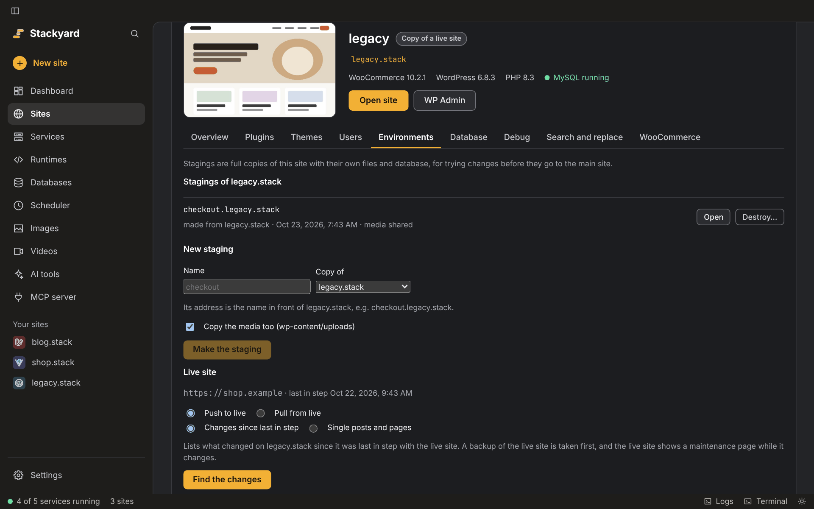

# WordPress and WooCommerce

Every WordPress site gets a **WordPress** tab in its tools: open **Sites**, click **Manage** (the
sliders button) on the site's row, then **WordPress**. It covers the everyday jobs that would otherwise need wp-admin or a
terminal. It is a module (Settings › Modules › *WordPress tools*); switched off, the tab is gone and
nothing is downloaded.

Plugins, themes, users and the WooCommerce actions use [WP-CLI](https://wp-cli.org), WordPress's
own command-line tool. Stackyard downloads it the first time one of them is used (one file, about
7 MB, into `tools/wp-cli` in Stackyard's folder), checked against the SHA-512 checksum WP-CLI
publishes next to it, and runs it with the site's own PHP version. The database server that holds
the site's database must be running (see [The database server](#the-database-server)).

## Clone a live site

**Sites › Clone from a live server…** copies a live WordPress or WooCommerce site to this computer
as a new site: files, database and settings. Nothing on the live site is changed. It needs the
*WordPress tools* and *Remote servers* modules.

1. Say where the live site is:
   - **A server (SFTP or FTP)**: the address, user name and password (or a private key for SFTP)
     your host gives you for SFTP or FTP. Optionally the folder the site is in; otherwise Stackyard
     looks for WordPress in the folder the server starts in and up to three levels below it.
   - **A saved server**: a connection you already saved for another site.
   - **Backup files**: a full backup downloaded from the hosting panel (cPanel, Plesk, DirectAdmin
     and others; `.tar.gz`, `.tar` or `.zip`, with archives inside archives opened too), or a zip
     of the site's files plus the database export (`.sql` or `.sql.gz`). Stackyard finds WordPress
     and the right `.sql` file in them.
2. Click **Look for WordPress**. Stackyard reads the live `wp-config.php` (you never type the
   database password) and shows the WordPress folder, the site's address, the WordPress, PHP and
   database versions, the database size, and how it will copy the site.
3. Pick a name for the copy (`shop` becomes `shop.stack`) and what to do with media:
   - **Download it all**, or
   - **Leave it on the live site**: nothing in `wp-content/uploads` is downloaded now. The first
     time a page asks for a file, the copy fetches it from the live site once and keeps it. Good for
     sites with many gigabytes of images.
4. Click **Clone** and follow the progress. **Stop** stops it; clicking **Clone** again with the
   same name continues where it stopped.

### How Stackyard reaches the live site

| The host offers | Files | Database |
|---|---|---|
| SSH (SFTP with a shell: most VPS, many managed hosts, cPanel with SSH on) | SFTP | `mysqldump` run on the server, table by table, compressed |
| SFTP or FTP only | SFTP, FTPS or FTP | Stackyard's helper, over the site's own address |
| Nothing usable | A backup from the hosting panel | From the backup |

The **helper** is a small PHP file Stackyard writes for this one copy and puts in the site's folder
on the server. It only reads the database, answers only requests that carry its random key, sends
the tables in chunks, and deletes itself when the clone ends, or after 30 minutes at the latest even
if the clone stopped halfway. When the server has SSH but no `mysqldump`, the helper is run with the
server's own PHP over SSH instead of the site's address. Without SSH, enter the **Live site's
address** so Stackyard can reach the helper there.

Big sites take time, so everything can continue after a dropped connection or **Stop**: files already
copied (same size and date) are skipped, a file that broke off is continued from where it stopped,
and the database comes in chunks whose progress is kept. Caches and the backups that backup plugins
keep inside the site (UpdraftPlus, All-in-One WP Migration, Duplicator and others) are not copied.

### What the copy gets

- Its own database, with every live address changed to the local one, in plain text, JSON and PHP
  serialized data (see Search and replace below), and the live server's folder path changed to the
  local folder.
- A `wp-config.php` for this computer: Stackyard's database, `WP_ENVIRONMENT_TYPE` set to `local`,
  `WP_HOME` and `WP_SITEURL` changed when they were set, the page cache (`WP_CACHE`) and
  `COOKIE_DOMAIN` switched off. The live file is kept as `wp-config.live.php`.
- The live site's PHP version, when Stackyard offers it (installed if needed); otherwise the
  default, and a note says so.
- An object cache drop-in (`wp-content/object-cache.php`, e.g. for Redis) is switched off, since its
  cache server is not on this computer.
- Safety settings, in the must-use plugin `wp-content/mu-plugins/stackyard.php`:
  - all mail goes to Mailpit (or, with Mailpit off, is dropped), never to real customers;
  - search engines are told not to index the copy;
  - scheduled tasks (WP-Cron) can't call outside services such as payment providers, CRMs or mail
    lists; the copy itself stays reachable;
  - WooCommerce webhooks are held back;
  - WooCommerce payment methods that have a test or sandbox mode are switched to it; those that
    have none are listed, so you can check them before testing checkout.
- The live server's connection, saved with the site as **Live** (Manage › Servers & Git), and the
  live address shown on the WordPress tab's Overview.

Premium plugins whose licence is tied to the live domain may show as unlicensed on the copy;
Stackyard can't change that. A multisite network's main site works; subsites on their own domains
may need their addresses changed under Network Admin › Sites.

## Stagings

A staging is a full copy of a local site, next to it, for trying something out without touching
the site itself: a new checkout, a plugin update, a redesign. When you are done, merge it back into
the site or delete it. Open the site's **WordPress** tab, then **Staging**.

1. Type a name, e.g. `checkout`. The staging's address is that name in front of the main site's:
   `checkout.shop.stack`.
2. Pick what it is a copy of: the local site or one of its stagings.
3. Choose whether to **copy the media too** (`wp-content/uploads`). Left out, the staging copies
   each image from the site it was made from the first time a page shows it: faster to make and
   much smaller for big shops.
4. Click **Make the staging**. **Stop** cancels it and removes what was made.

Each staging gets:

- its own folder beside the main site's (`~/Code/shop@checkout` for `~/Code/shop`). On disks that
  can share blocks between files (APFS on macOS, Btrfs and XFS on Linux) the copy takes almost no
  time and no extra space until files change;
- its own database (`shop_checkout`), with every address changed to the staging's;
- `WP_ENVIRONMENT_TYPE` set to `staging`, and **Staging: checkout** in an orange label in the admin
  bar, so it is never taken for the main site;
- the main site's safety settings when the main site is a copy of a live site (mail to Mailpit and
  the rest, see above);
- a *starting point*: the database and a list of every file with a checksum, as they were when the
  staging was made. Merging a staging back compares both sides against it, to tell what changed
  where.

A staging is a site like any other: it shows under Sites, has its own tools, and can get a public
link (Manage › Public link) when someone else needs to look at it. Public links are off unless you
switch them on, for each staging.

**Delete…** moves a staging to the **Trash**: its folder, database and snapshots are kept for
7 days. **Bring back** puts it back as it was; **Delete now** removes it for good. Only stagings can
be deleted this way; the main site is removed under Sites as before.

### Merging a staging

When the work on a staging is done, click **Merge into shop.stack…** beside it in the site's
**Staging** tab, or open the **staging's** own WordPress tab, then **Staging**. **Merge into another
copy** takes it into the main site or another staging (**Into**).

**Changes since the staging was made** compares the staging, and the copy it goes into, with the
staging's starting point. **Find the changes** lists:

- **Files**, grouped by plugin, theme, media and the rest. A file the other copy also changed since
  then, differently, is marked **changed on both** and left unticked: you decide.
- **Plugins and theme** switched on or off on the staging.
- **Settings** (WordPress options, WooCommerce settings, widgets, theme settings) with the value on
  each side. Things that belong to each copy (its address, caches, Stackyard's own settings) are
  never listed.

Then pick how much to merge:

- **Code**: the ticked files and plugin and theme switches. The other copy keeps its whole database.
  The safe choice for a new theme, plugin or code change.
- **Settings**: Code, plus the ticked settings.
- **Everything**: Code, plus the staging's whole database: posts, pages, products, menus and
  settings. The other copy's **users, orders and customers are kept** (for stores with and without
  High-Performance Order Storage). Posts made on the other copy since the staging was made are
  replaced, and the screen says how many; move them to the staging first if you need them. Type the
  site's name to confirm.

A snapshot of the copy it goes into is taken first. **Undo** right after the merge, or **Undo…**
under that copy's snapshots later, puts it back.

### Moving single posts and pages

**Single posts and pages** moves just the content you pick, without touching anything else. Search by
title or slug, tick the posts, pages or products, and click **Preview**. The preview lists:

- what moves, with what comes along: featured images and images in the content, galleries,
  reusable blocks and patterns;
- for each one the other copy already has (same type and slug): **Replace the one there**,
  **Add as a new one** or **Leave it out**;
- how many media files, categories and tags (and which are new) and comments (tick **Take their
  comments too**) go with them.

Posts get new numbers in the other copy, so every number that points to another post is changed to
match: featured images, block attributes and `wp-image-…` classes, gallery shortcodes, parent pages,
menu items, WooCommerce gallery, upsell and cross-sell lists, Elementor data, Yoast SEO and Rank
Math primary categories, and Advanced Custom Fields image, file, gallery, post and relationship
fields. Images the other copy already has (same file) are reused, not copied twice. Authors are
matched by login; an author the other copy doesn't have becomes its first administrator.

Where a plugin keeps a number Stackyard can't check safely, the preview says so under **Can't be
changed safely** instead of guessing: those values are copied as they are, for you to check.

**Move** takes a snapshot of the other copy first, so **Undo** puts it back.

## Push and pull

A copy cloned from a live server has a **Live site** tab in **Manage › Servers & Git**, to send
your work up (**Push to live**) or bring the live site's changes down (**Pull from live**). The
**Pull from live** and **Push to live** buttons at the top of the WordPress tab open it. Stackyard
keeps a record of both sides each time they are in step (after the clone, and after each push or
pull), so it can tell which side changed what since then.

**Changes since last in step** lists, like a merge: changed files grouped by plugin, theme and so
on, plugins and theme switched on or off, and settings. Anything both sides changed is marked and
left unticked for you to decide. Then pick how much:

| Level | Push | Pull |
|---|---|---|
| **Code** | The ticked files, and which plugins and theme are on. The live database stays as it is. | The same, the other way. |
| **Settings** | Code, plus the settings you tick. | The same, the other way. |
| **Everything** | Code, plus this copy's whole database, with the live addresses put back. The live site's orders, customers, payment settings and users added since are kept. | Code, plus the live site's whole database, with local addresses and payments in test mode, like a clone. |

A push is made safe step by step:

1. It backs up first: the whole live database and every live file the push replaces or removes.
   The backups are listed under **Backups of the live site**; **Put back on live** restores one,
   and **Undo** right after a push does the same.
2. The live site shows WordPress's own maintenance page while it changes.
3. Files go up, then the database changes. If anything fails, the backup is put back by itself.
4. After it, Stackyard checks that the home page and the login page still answer, and says so if
   they don't.

**Everything** on a push asks you to type the site's name, and refuses when posts or comments
changed on the live site since the copy was last in step (orders and their notes don't count, they
are kept anyway): pull those first, or move them as single posts. A pull takes a snapshot of the
copy first, so it can be undone from **Snapshots**.

The live site's database is changed through the same helper a clone uses (over SSH when the server
has it, else over the site's address), which sends the SQL in resumable pieces and deletes itself
when the step ends.

**Single posts and pages** works like moving them between copies, in either direction. **Read the
live site** first copies the live database into a local mirror, so you can search and preview without
a connection; a push reads it again just before it moves anything, under the maintenance page, so the
new post numbers it gives out are free. A push of single posts backs up the live database first; a
pull takes a snapshot of the copy.

### Snapshots

Before Stackyard changes a copy (merges and pulls), it takes a snapshot: the whole database
and every file the step is about to change. The WordPress › Staging tab lists the last 5 snapshots of the
site you are looking at. **Undo…** puts the database and those files back and removes files the step
added; a snapshot of how things were just before is taken first, so the undo can itself be undone.
Files the step never touched are left alone.

## Terminal and AI tools

Everything above works from a terminal too, with `stackyard wp`: `clone`, `staging new|list|merge|destroy`,
`push`, `pull` and `snapshots`. Merges, pushes and pulls only list the changes until you add
`--yes`; `--level code|settings|everything` picks how much, `--all` also takes what both sides
changed, `--posts 12,40` moves just those posts and pages, and `--level everything` needs
`--confirm <site name>`. Any other command goes to WP-CLI, in the site of the folder you are in, or
in another with `--site=shop.stack`, for example `stackyard wp plugin list`. See
[the terminal guide](cli.md).

### Debug settings on a copy of a live site

The **Debug** tab (`WP_DEBUG`, `WP_DEBUG_LOG`, `WP_DEBUG_DISPLAY`, `SCRIPT_DEBUG`, `SAVEQUERIES`)
changes only this copy's `wp-config.php`. A push never sends `wp-config.php`, and neither does a
plain Upload under Servers, so whatever you switch on locally stays local and the live site keeps its
own. Each setting starts the way the live site has it, and shows **On on live** or **Off on live**
beside it (read again from the live `wp-config.php` on each compare, push and pull). **Set back to
how live has it** puts this copy's settings back to the live ones.

AI coding tools connected to Stackyard's [MCP server](mcp.md) can list the environments, and once
you allow each one, make a staging, run WP-CLI in a local site, merge a staging and destroy one.
Pushing to or pulling from the live site is never offered to them.

## Overview

The top of the tab works like Local or WordPress Studio: the site's name and address, the WooCommerce, WordPress and PHP versions, whether its database server runs,
and the two buttons used most, **Open site** and **WP Admin**. Under it:

- **Site details**: the domain, the HTTPS certificate, the web server, PHP version, the database
  (its name, the server that holds it and whether that server runs), the table prefix, the
  WordPress and WooCommerce versions, the environment (`WP_ENVIRONMENT_TYPE`), and how much disk
  the site, its media, plugins, themes and database take. Warnings appear when `wp-config.php`
  points at another database server than Stackyard's, or shows errors on the pages. A cloned site
  also shows its live site's address and when it was copied. **Check for a WordPress update** asks
  wordpress.org and offers the update.
- **Customize**: shortcuts into wp-admin. A block theme gets the Site editor, Styles and Patterns;
  a classic theme gets the Customizer, Menus and Widgets. Every site gets Pages, Posts, Media,
  Settings and Permalinks.
- **Tools**: the Plugins, Themes, Users and Debug tabs, and the mail Mailpit caught.

### The site's picture

The picture at the top of the site's tab is a screenshot of the home page taken while the web
server runs, by a Chromium browser already on the computer (Microsoft Edge, which every Windows
has, or Google Chrome, Chromium or Brave) running hidden. It is shrunk to a small JPEG in
`cache/thumbnails` and taken again when it is a day old; **New picture** (over the picture) takes
one now, and says why when it can't. A page that comes out blank is tried once more with longer to
load, and otherwise no picture is kept. Without such a browser, or before the web server first
runs, the picture is the active theme's own `screenshot.png`, and without that the WordPress logo.
The Sites list shows the same picture for every site.

### The database server

MySQL and MariaDB keep their databases apart and use the same port, so only one of them runs at a
time. A site whose database is in MariaDB shows "Error establishing a database connection" while
MySQL runs. Stackyard looks in both servers' data folders to see which one has the site's database
(named by `DB_NAME` in `wp-config.php`, or picked in the site's Settings), and when that server is
not running it says so on top of the tab and in the Sites list, with **Start MariaDB** (or **Stop
MySQL and start MariaDB** when the other one has the port). Tick **Start MariaDB whenever the web
server starts** to have it started with the web server from then on; a server whose port another
one already uses is left alone then, so nothing running is ever stopped behind your back.

## Plugins and themes

Plugins are listed as wp-admin's Plugins screen lists them: active ones marked on the left, with
**Activate**, **Deactivate** and **Delete** (for inactive ones), a note with **Update now** when a
new version is out, filters for All, Active, Inactive and Update available, and a search box.
Themes show as cards with each theme's own picture; the active one has **Customize**, the others
**Activate** and **Delete**. **Install** adds one from wordpress.org by its slug (the last part of
its wordpress.org address, e.g. `query-monitor`); **Install and activate** activates it too.

The lists are kept while the app runs, so going back to a tab shows them at once and reads them
again quietly. The first time a list is opened, Stackyard also asks wordpress.org for updates,
which takes a few seconds; after that the updates shown are the ones WordPress itself last found,
and **Check for updates** asks again. WP-CLI is downloaded only once, the first time any of this is
used.

WP-CLI loads WordPress without the other plugins for these jobs, so a broken plugin can't stop
you from deactivating it. Activating or deactivating a plugin loads them all, as wp-admin does, so
its own setup runs.

## Users

- **Log in as** opens the site in the browser already logged in as that user. The link works once,
  for five minutes. It goes through a small must-use plugin Stackyard writes into the site
  (`wp-content/mu-plugins/stackyard.php`), which also shows the copy's name (Local, Staging) in the
  admin bar.
- **New password** sets a new random password and shows it.
- **Add an administrator** makes a new administrator account.

## Debug

Switches for `WP_DEBUG`, `WP_DEBUG_LOG`, `WP_DEBUG_DISPLAY`, `SCRIPT_DEBUG` and `SAVEQUERIES`,
written straight into `wp-config.php`, and `debug.log` underneath, followed live (every two
seconds) while **Follow** is ticked. **Clear** empties the log.

## Search and replace

Finds text everywhere in the site's database and replaces it, for example an old address after a
move. It works on PHP serialized data too (widgets, theme settings, page builders such as Elementor
and Divi), whose string lengths it counts again; a plain text replace would break those. JSON
(`https:\/\/example.com`) and URL-encoded (`https%3A%2F%2Fexample.com`) forms are changed as well.

With **These are site addresses** ticked, `http://` and `https://`, with and without `www.`, and
`//example.com` all become the new address, while other domains that only start the same way
(`example.com.au`, `example.community`) and e-mail addresses are left alone.

**Preview** counts the places per table without changing anything. **Replace** backs the database
up first (Databases screen › Backups), then makes the change. The preview also lists values it
could not change safely: serialized data that was already damaged, and base64-encoded values that
hold the text.

## Database

- **Export…** saves the site's database as `.sql` or, with a name ending `.sql.gz`, compressed.
- **Import…** loads a `.sql` or `.sql.gz` file. Its tables replace the ones of the same name; a
  backup is taken first.
- **Optimize tables** runs `OPTIMIZE TABLE` on every table.
- **Clear transients** removes WordPress's cached values (they are made again when needed).
- **Open in phpMyAdmin** when the phpMyAdmin module is on.

## WooCommerce

Shown when WooCommerce is installed.

- How orders are stored: in WooCommerce's own tables (High-Performance Order Storage, the default
  since WooCommerce 8.2) or as posts, read from the store's settings. Every tool works with both.
- Counts of orders, products and customers, and scheduled actions that are due or failed.
- **Run due actions** runs the scheduled actions that are due (e-mails, webhooks, renewals), as
  the site's cron would.
- **Make 3 test orders** and **Make 3 test customers**. Customers get `@example.test` addresses,
  which never receive mail.
- **Payment methods**: each one that is set up, whether it is on, and whether it is in test mode.
  **Switch to test mode** works for gateways that keep a test switch in their settings (Stripe,
  PayPal and most others); for the rest, use their own settings page.

---

[← Back to the README](../README.md)
